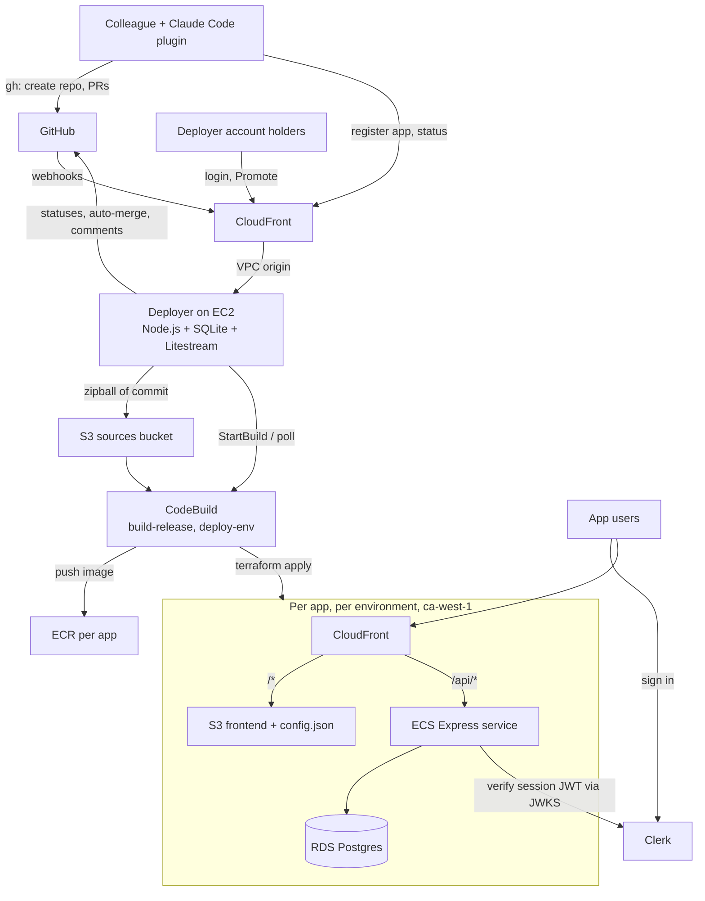

# slipway: Design Doc

**Status:** Draft v8
**Owner:** Dev team
**Last updated:** October 12, 2026
**Region:** `ca-west-1` (Canada West, Calgary) for the first deployment; now any region you choose, dedicated to slipway (item 11)

> This design was written for slipway's first deployment: one company's GitHub org and one AWS account in `ca-west-1`. Keep reading it for the reasoning. For the current setup, where anyone installs the plugin and `/setup` puts slipway in their own AWS account with apps under their own GitHub org or personal account (items 11–13), [foundation.md](foundation.md) and [contracts.md](contracts.md) win where they differ. Here, `acme` stands for the GitHub owner that holds app repos, and "the dev team" for whoever runs your slipway. Apps no longer come with sign-in (item 12): wherever this document mentions Clerk, read "no sign-in until the app's developer adds authentication".

## Changes since Draft v7

These changes came out of building the platform and checking the region. Where they conflict with the sections below, this list wins. The exact names, settings and interfaces are in [contracts.md](contracts.md).

1. **No CodeBuild.** AWS CodeBuild (and CodePipeline) isn't available in `ca-west-1`. Builds and deploys run on the deployer instance in a second process, the **runner**, which takes jobs from the deployer over a local Unix socket. Wherever this document says "CodeBuild", "`build-release` project" or "`deploy-env` project", read "the runner's `build-release` or `deploy-env` job". The runner works in every region, so it stays wherever slipway runs.
2. **Isolation on the box.** The deployer, the runner and untrusted build steps run as three Linux users. Anything that executes app code (`npm ci`, type check, lint, tests, frontend build) runs as `slipway-build`, which can't reach the instance's AWS credentials, the deployer's data or its port. Docker image builds and Terraform run as the runner.
3. **The deployer holds deploy permissions.** Section 7's "the deployer holds the least AWS power" no longer holds: the instance role can do anything in its region (the region is dedicated to slipway). It can manage only slipway's own resources in the global services (IAM, CloudFront, S3). Roles that app deploys create still carry the `slipway-boundary` permissions boundary. Isolation now rests on untrusted code running without credentials.
4. **Deployer hosting.** One `t3.small` (x86_64, because it builds `linux/amd64` images) in a public subnet of the default VPC, with an Elastic IP. pm2 runs the deployer and the runner and rotates their logs (pm2-logrotate); Caddy listens on port 8080. CloudFront stays in front for HTTPS. The instance accepts traffic only from CloudFront's origin-facing IP ranges, and Caddy rejects requests without CloudFront's secret origin header. The CloudFront-to-instance hop is plain HTTP. No private subnets, no NAT gateway, no VPC origin.
5. **Lean foundation.** The default VPC replaces the custom one. One artifacts bucket holds app releases and deployer releases. The AWS-managed `aws/ssm` key replaces the platform KMS key: the deployer still can't read secret values, because it has no `ssm:GetParameter` on `/apps/*`. Platform secrets (one per Clerk application holding both of its keys, and the GitHub App) are created by hand when their values exist, not by Terraform. Parameter Store holds only app secrets. Per-app modules find shared resources by naming convention.
6. **Database classes.** RDS in `ca-west-1` offers no `db.t4g` classes for Postgres. The size presets use `db.t3.micro`, `db.t3.small` and `db.t3.medium`, in every region.
7. **App images are x86.** The Terraform resource for Express Mode has no CPU architecture setting, so app tasks run on X86_64, not Graviton.
8. **No Litestream, no deployer backups yet.** The deployer's SQLite database lives only on the instance's EBS volume. EC2's automatic recovery keeps the volume, but replacing or terminating the instance loses the dashboard accounts, the app registry and job history (apps keep running). EBS snapshots will be added later. Until then, wherever this document mentions Litestream, there is no replication.
9. **Known open risk: the GitHub App sees every repo of its owner.** The deployer's App is installed on all repositories of the org or personal account that owns app repos. Anyone who compromises the deployer instance gets write access to their contents and settings, so use an org (or account) that holds only slipway apps. The plan is to narrow this later. One option: drop the Administration and Members permissions, install on selected repositories, and have `/new-app` add each app repo and set its branch protection with the colleague's own `gh` login. Another: a separate GitHub org for slipway apps.
10. **Names.** The product is slipway. Each install creates its own GitHub App with a name of its choosing (App names are unique across GitHub; for example `slipway-<owner>`), and its own Clerk applications (suggested: `slipway-local`, `slipway-stage`, `slipway-production`). Commit statuses are `slipway/check` and `slipway/deploy-*`. The stack skill is `slipway-stack`. The plugin marketplace is `slipway`.
11. **Bring your own GitHub and AWS.** slipway is self-hosted: anyone runs it in their own AWS account and on their own GitHub org or personal account.
    - **Owner.** `github_owner` names the org or personal account that owns app repos. The deployer finds its App's installation on it as an org or as a user, and asks GitHub for its own slug (`GET /app`) instead of being configured with it.
    - **Access.** In an org, plugin API access is org membership, as before. On a personal account, it's the owner plus `github_allowed_users`; only the owner can run `/new-app`, because nobody else can create repos there.
    - **Branch protection.** Push restrictions (only the App may push to `main`) are set on org repos only; GitHub has none for personal repos. GitHub Free can't protect private repos at all: registration then succeeds with a warning and `main` stays unprotected.
    - **CODEOWNERS.** New apps get `github_codeowners`, or by default the owner (personal account) or the app's creator (org), instead of a fixed team.
    - **Region.** Required everywhere (Terraform, the deployer, the runner, `release.sh`), with no default. It must still be dedicated to slipway; a dedicated AWS account is best.
    - **Plugin setup.** The plugin has no built-in org or deployer URL: it saves one in `~/.config/slipway/config.json` (`/setup` or `/connect`, item 13) and learns the owner and the CODEOWNERS entry from `GET /api/whoami`.
    - **One repo.** The platform and the plugin live in one repo, which is also the plugin's root (item 13); the plugin's commands, skills, hooks, CLI and template are in `plugin/`.
12. **No sign-in.** The platform no longer includes Clerk or any other auth provider: a new app is public to anyone with its link, and whether and how to add sign-in is up to its developer. Gone with it: the Clerk applications and their `slipway/clerk/*` secrets (items 5 and 10), the `auth` field in `app.yaml`, the `CLERK_*` container variables, the Clerk key in `config.json` (it now holds only `env` and `release`), the deployer's `GET /api/dev-config`, and the template's `requireUser` and `users` table (its sample is now a public notes list). A provider's secret key is an app secret like any other (`secrets:` in `app.yaml`, set with `/secret`).
13. **A public plugin that sets itself up.** Anyone installs the plugin from the public marketplace and runs `/setup`. It puts slipway in their own AWS account, using their own AWS credentials. That's the only time the plugin uses AWS credentials; everything after goes through the deployer's API, as before. It:
    - creates the state bucket with the AWS CLI (the Terraform bootstrap stack is gone);
    - applies the foundation from a copy of the plugin's own `foundation/`, with its inputs stored next to its state, and stops before any plan that replaces or deletes a resource;
    - creates the GitHub App through GitHub's manifest flow, so nobody copies keys by hand;
    - releases the deployer at the plugin's version, and creates the first dashboard admin through SSM Run Command.

    Running `/setup` again updates everything. Others who share a deployer run `/connect <url>`. Because an installed plugin only gets its own directory, the repo root is the plugin's root (marketplace source `.`), so `/setup` has `foundation/`, `deployer/`, `jobs/` and `modules/` next to it. The allowed users and the CODEOWNERS entry moved from user data to the SSM parameter `/slipway/deployer/github-access`, so changing them restarts the deployer instead of replacing the instance. [foundation.md](foundation.md) has the details.

## 1. Summary

Colleagues run `/new-app` from our **slipway** Claude Code plugin and get back a GitHub repo and a working staging link a few minutes later. Every app gets its own staging and prod environments in our AWS account in `ca-west-1`: a Postgres database on RDS, an API on ECS Express Mode, and a frontend on S3 + CloudFront. Sign-in is handled by Clerk, already wired into the template.

A small deployer service, one Node.js process on one EC2 instance, watches GitHub. Pull requests merge automatically once their checks pass, and every merge to `main` deploys to staging. A dashboard lets anyone with a deployer account promote a staging release to prod, or roll back.

Agents write code and open pull requests. They never deploy. All builds and deploys run in CodeBuild using scripts the dev team owns.

## 2. Goals and non-goals

**Goals**

- One command from idea to a live staging URL with working sign-in, with no AWS knowledge or credentials on colleagues' laptops.
- Move fast: in v1, a passing PR is merged and on staging within minutes, with no waiting for review.
- One GitHub repo per app, holding the app's code and nothing about how it's deployed.
- Identical staging and prod environments, with prod getting the exact build that was tested on staging.
- The dev team controls all infrastructure and all deploy logic.
- Infrastructure simple enough for a small team to run: one deployer process on one box, managed services for everything else.
- All app data stays in one region (`ca-west-1` for the first deployment).

**Non-goals (for now)**

- Custom domains. Apps get CloudFront URLs (`https://dxxxx.cloudfront.net`).
- SSO for the deployer dashboard. v1 uses local accounts; Google sign-in comes later.
- Human review before merge. v1 merges on passing checks.
- Per-PR preview environments.
- Building our own coding agent. Colleagues use Claude Code with our plugin.
- Multi-region or high availability for the deployer.

## 3. How it works for a colleague

1. Install the plugin once: `/plugin marketplace add sameid/slipway`, then install `slipway`.
2. Run `/new-app`. Answer three questions: app name, template, one-line description.
3. The plugin creates `acme/<name>` on GitHub from the template, registers it with the deployer, and waits.
4. About 10–15 minutes later (mostly RDS creating the database), the plugin prints the staging link. Opening it shows a Clerk sign-in screen; signing in with an email Clerk allows works immediately.
5. Build features with Claude Code. Nothing runs on the laptop: every change is previewed on staging. `/ship` commits to a branch and opens a PR. Once the checks pass, the deployer merges it and deploys staging. `/ship` waits and prints the updated staging link.
6. `/status` shows what's on staging and prod.
7. When ready for prod, sign in to the deployer dashboard and press Promote.

## 4. Architecture



There's one platform repo (originally two), plus one repo per app:

| Repo | Owner | Contents |
|---|---|---|
| `sameid/slipway` (root) | Dev team | Foundation Terraform, the per-app Terraform module, CodeBuild buildspecs, deployer source |
| `sameid/slipway` (`plugin/`) | Dev team | The Claude Code plugin and app templates |
| `acme/<app-name>` | Colleague | App code and `app.yaml` |

## 5. Components

### 5.1 Claude Code plugin: slipway

The plugin is called **slipway**. Its commands can be run as `/new-app` or, when another plugin has a command with the same name, as `/slipway:new-app`. It's distributed as a plugin marketplace repo (`sameid/slipway`) the dev team controls. Updates reach everyone when they update the plugin.

```
slipway/
  .claude-plugin/
    plugin.json
    marketplace.json
  commands/
    new-app.md        # interview, scaffold, create repo, register, wait for URL
    ship.md           # branch, commit, push, open PR, wait for merge + staging
    status.md         # staging/prod release, last deploy result, links
    destroy-app.md    # request teardown (confirmed on the dashboard)
    secret.md         # list secrets, or get a one-time link to set one
  skills/
    slipway-stack/SKILL.md   # house conventions for the default stack (see 5.2)
    coding-agent/
      SKILL.md            # every feature, fix or enhancement gets its own worktree; several run as background agents
      scripts/
        new-worktree.sh   # create worktree + branch, npm ci
        clean-worktrees.sh  # remove worktrees whose PRs are merged or closed
  hooks/
    hooks.json        # blocks edits to .github/, CODEOWNERS, app.yaml platform fields
  templates/
    react-express/    # default template
```

**`/new-app` steps**

1. Validate the name: lowercase letters, digits and hyphens, 3–20 characters, not already taken (checked with the deployer API).
2. Copy `templates/react-express/` to a new folder and fill in the name and description.
3. `gh repo create acme/<name> --private --source . --push`.
4. `POST /api/apps` to the deployer with the repo name, authenticated with `gh auth token`.
5. Poll `GET /api/apps/<name>` every 15 seconds and show progress (registering, building, deploying staging).
6. Print the staging URL and the repo URL.

**`/ship` steps** (run from inside the task's worktree)

1. Commit, fetch `origin/main` and rebase onto it. If a Drizzle migration conflicts, regenerate it on top of `main` (see 5.9).
2. Push the worktree's branch and open a PR with `gh pr create`, or update the existing one.
3. Poll the deployer for the PR's state: checking, merged, deploying, live.
4. If the check fails, show the failing step and log link so Claude can fix it and push again.
5. When staging is live, print the staging link and offer to remove the worktree.

**Coding-agent skill: one worktree per task**

Colleagues often want several things in flight at once: a feature, a bug fix and a tweak. The `coding-agent` skill makes each one independent. Its description triggers whenever the colleague asks to build a feature, fix a bug or make an enhancement.

1. Pick a short branch name from the request, such as `feat/loan-reminders` or `fix/date-filter`.
2. Run `new-worktree.sh <branch>`, which:
   - fetches `origin/main` and runs `git worktree add ../<app>-worktrees/<branch> -b <branch> origin/main`, so every task starts from the latest `main`, not from whatever the main checkout has;
   - runs `npm ci`, so tests, typecheck and lint can run there.
3. Do all the work and tests inside that worktree. Apps aren't run locally; the colleague previews the change on staging after `/ship`.
4. Finish with `/ship` from the worktree.

When one request asks for several independent things, the skill splits them into tasks and starts one background agent per task (at most 4 at a time), each in its own worktree and finishing with `/ship`; the main session coordinates and relays each PR and what to try on staging. The colleague can also start a second Claude Code session for another task, and the skill gives it a separate worktree. Each task has its own branch and PR, so they never step on each other. `clean-worktrees.sh` removes worktrees whose PRs have merged or closed; `/status` reminds the colleague when there are some to clean up.

The skill never works directly in the main checkout. The main checkout stays on `main` as a clean starting point.

**Guardrails in the plugin**

- Hooks stop the agent from editing `.github/`, `CODEOWNERS` and the platform-owned fields in `app.yaml`.
- Claude never pushes to `main`. Branch protection enforces this on GitHub regardless.
- Colleagues need no AWS credentials. The plugin only uses `gh` and the deployer API.
- No Clerk keys reach a laptop. Staging and prod Clerk secret keys stay in AWS.
- Secret values never pass through the Claude Code conversation. `/secret set` hands back a browser link instead (see 5.8).

### 5.2 App repo and default template

**Default stack**

| Layer | Choice |
|---|---|
| Frontend | React, TanStack Query, Tailwind CSS, built with Vite |
| Auth | Clerk (React SDK in the frontend, `@clerk/express` in the API) |
| Backend | Node.js, Express, Drizzle ORM (`node-postgres` driver) |
| Database | Postgres on RDS |
| Tests | Vitest for both packages |

**Layout**

```
my-app/
  app.yaml              # app manifest (see below)
  package.json          # npm workspaces: api, web
  api/
    src/
      index.ts          # Express app; clerkMiddleware(); routes under /api
      auth.ts           # requireUser middleware: 401 if signed out, upserts local user
      routes/
        me.ts           # GET /api/me: the signed-in user's local record
      db/
        schema.ts       # Drizzle schema, starts with a users table
        client.ts       # connection pool, reads DB secret (see below)
      migrate.ts        # runs Drizzle migrations; compiled to dist/migrate.js
    drizzle/            # generated SQL migrations (drizzle-kit generate)
    drizzle.config.ts
    Dockerfile
  web/
    src/
      main.tsx          # loads /config.json, then ClerkProvider + QueryClientProvider
      api.ts            # fetch helper: relative /api paths + Clerk session token
      App.tsx           # signed-out: <SignIn />; signed-in: app + <UserButton />
    vite.config.ts      # dev server proxies /api to localhost:3000, serves config.json
    tailwind.config.ts
  CLAUDE.md             # conventions Claude Code follows in the repo
  CODEOWNERS            # dev team owns app.yaml
```

The app repo contains **no Terraform and no build scripts**. All infrastructure and deploy logic lives in `sameid/slipway`, so nothing a colleague or agent changes in the app repo can alter how infrastructure is built or what permissions a deploy has.

**Template conventions** (also in the `slipway-stack` skill and `CLAUDE.md`)

- Every API route lives under `/api`. The frontend only uses relative `/api/...` URLs, so the same build works locally, on staging and on prod.
- Every API route except `/api/health` uses `requireUser`. Public routes must be added deliberately.
- Schema changes go in `api/src/db/schema.ts`, followed by `drizzle-kit generate` to create a migration. Migrations are committed and must be additive and backward compatible (add columns and tables; drop things in a later release).
- Server state in the frontend goes through TanStack Query hooks using the `api.ts` helper; no ad hoc `fetch` calls in components.
- `GET /api/health` is public and returns 200 only when the database is reachable.
- Third-party keys are read from `process.env`, declared by name in `app.yaml`, and never committed (see 5.8).

**Auth with Clerk**

*Frontend*

- `main.tsx` fetches `/config.json` (written per environment at deploy time) to get the Clerk publishable key, then renders `ClerkProvider` with it. Loading the key at runtime keeps the frontend build identical across environments.
- Signed-out users see Clerk's `<SignIn />`; signed-in users get the app with a `<UserButton />`.
- `api.ts` gets the session token from Clerk's `getToken()` and sends it as `Authorization: Bearer <token>` on every request. Using the header rather than relying on cookies behaves the same with development and production Clerk instances.

*Backend*

- `clerkMiddleware()` from `@clerk/express` runs on every request. It reads the session token from the request's cookies and headers and verifies it locally against Clerk's public keys, so checking a session costs no Clerk API call.
- `requireUser` (in `auth.ts`) calls `getAuth(req)`. If the user isn't authenticated it returns `401` JSON. The template avoids Clerk's `requireAuth()`, which redirects instead of returning 401, the wrong behavior for a JSON API.
- On a user's first request, `requireUser` upserts a row in the app's own `users` table keyed by the Clerk user ID, copying name and email from the session's claims. App data references this local row. This also avoids calling Clerk's Backend API on every request, which matters because the Backend API is rate limited per Clerk instance and all apps share an instance (see 5.4).
- Authorization (who may do what within an app) is the app's job, in its own tables. Being signed in to Clerk only proves the user is a colleague.

**Database credentials**

RDS manages the master password in Secrets Manager and rotates it automatically. A password injected into the container at startup would go stale after a rotation, so `db/client.ts` reads the secret from Secrets Manager when it creates the pool, and on an authentication error it re-reads the secret and reconnects. The task role is allowed to read only that app and environment's secret. The host, port and database name come from environment variables.

**No local running**

Apps don't run on a colleague's laptop, so there's no Docker, local Postgres, dev server or `.env`. Claude checks its work with tests (which mock the database), typecheck and lint, and the colleague previews every change on staging once its PR merges. This keeps setup to Node and the GitHub CLI.

**`app.yaml`**

```yaml
name: my-app
template: react-express
description: Tracks equipment loans for the ops team
owner: jane.doe            # GitHub username

api:
  port: 3000
  health_check: /api/health
  migrate_command: ["node", "dist/migrate.js"]

web:
  build_command: npm run build --workspace web
  output_dir: web/dist

secrets:                   # names only; values are set with /secret (see 5.8)
  - STRIPE_KEY
  - OPENAI_API_KEY

# Platform-owned (dev team approval required to change)
auth: clerk
auto_merge: true
sizes:
  staging: small
  prod: small
```

Sizes map to fixed presets defined in the platform module, for example:

| Size | Fargate CPU / memory | RDS instance | RDS storage |
|---|---|---|---|
| small | 0.25 vCPU / 0.5 GB | db.t3.micro | 20 GB |
| medium | 0.5 vCPU / 1 GB | db.t3.small | 50 GB |
| large | 1 vCPU / 2 GB | db.t3.medium | 100 GB |

`ca-west-1` offers no `db.t4g` classes for RDS Postgres (checked October 2026), so the presets use `db.t3`.

### 5.3 Per-app infrastructure

Each app has three Terraform stacks, each with its own state file:

| Stack | State key | Resources |
|---|---|---|
| shared | `apps/<name>/shared.tfstate` | ECR repository, CloudWatch log group, release artifact prefix |
| staging | `apps/<name>/staging.tfstate` | One full environment |
| prod | `apps/<name>/prod.tfstate` | One full environment |

The ECR repository is shared by both environments, so promotion deploys the exact same image digest.

**One environment contains:**

- **RDS Postgres**: single instance in private subnets of the shared VPC, with the master password managed by RDS in Secrets Manager (`manage_master_user_password = true`). Prod adds deletion protection, 14-day backups and a final snapshot on delete.
- **ECS Express Mode service**: created with `aws_ecs_express_gateway_service` (AWS provider ≥ 6.23). Express Mode provides the Fargate service, a load balancer with TLS, auto scaling and a public `*.ecs.ca-west-1.on.aws` URL. Services sharing a network configuration share a load balancer. ECS keeps deleted service names reserved, so service names get a short random suffix. A separate `migrate` task definition, using the same image and database access, runs migrations as a one-off task (see 5.9). Environment variables: `DB_HOST`, `DB_PORT`, `DB_NAME`, `DB_SECRET_ARN`, `CLERK_PUBLISHABLE_KEY`. Secrets injected by ECS: `CLERK_SECRET_KEY` from that environment's shared Clerk secret, plus every app secret declared in `app.yaml` (see 5.8).
- **S3 bucket**: private, holds the frontend build and `config.json`, readable only by CloudFront through origin access control.
- **CloudFront distribution** with these behaviors:

| Path | Origin | Cache policy | Origin request policy |
|---|---|---|---|
| `/api/*` | ECS Express URL (HTTPS) | `CachingDisabled` | `AllViewerExceptHostHeader` |
| `/config.json` | S3 bucket | `CachingDisabled` | none |
| `/*` (default) | S3 bucket | `CachingOptimized` | none |

Routing the API through CloudFront puts the frontend and API on one domain, so there is **no CORS**, and the frontend build contains no environment-specific URLs. The `AllViewerExceptHostHeader` policy is required: Express Mode load balancers route by host name, so forwarding CloudFront's host header would break routing. The default path also returns `index.html` for unknown paths, so client-side routes work on refresh.

`config.json` is written by `deploy-env` on every deploy:

```json
{ "clerkPublishableKey": "pk_test_...", "env": "staging", "release": "a1b2c3d" }
```

**Both environments start empty.** Each gets its own new RDS instance, and the first deploy's migrations create the schema. No data is ever copied between environments. App users sign in through Clerk; their local `users` rows are created on first visit to each environment.

**Naming and tagging**

Every resource is named `app-<name>-<env>-<resource>` and tagged `platform=slipway`, `app=<name>`, `env=<env>`. The deploy role's permissions are scoped to these names and tags.

### 5.4 Shared foundation

Created once by the dev team from `foundation/`, all in `ca-west-1` except where noted:

- **VPC** with public and private subnets across two availability zones, and NAT for outbound traffic from private subnets.
- **Terraform state bucket** with versioning, encryption, and S3-native locking (`use_lockfile = true`, Terraform ≥ 1.10).
- **Sources bucket**: the deployer uploads a zipball of each commit here for CodeBuild to build (`sources/<app>/<sha>.zip`), expiring after 7 days.
- **Release artifacts bucket** for frontend builds (`releases/<app>/<sha>/web.tgz`).
- **CodeBuild projects** `build-release` and `deploy-env` and their IAM roles.
- **GitHub App** (`slipway-deployer`), installed on all repos in the org.
- **Clerk applications and secrets** (see below).
- **KMS key** `alias/slipway-secrets`, used to encrypt app secrets in Parameter Store (see 5.8).
- **The deployer**: EC2 instance, its IAM role, its CloudFront distribution and VPC origin, and the Litestream backup bucket.

CloudFront is a global service; its distributions serve from edge locations worldwide, while every origin (S3, ECS, RDS, the deployer) stays in `ca-west-1`. When custom domains arrive, their CloudFront certificates must be created in ACM in `us-east-1`, which is a CloudFront requirement.

**Region availability check (rollout step 1)**

`ca-west-1` is a newer region. Before building, confirm in the console or docs that each of these is available there: ECS Express Mode and Fargate (including ARM/Graviton), `t4g` EC2 instances, `db.t4g` RDS instances (not offered for Postgres in `ca-west-1`; the presets use `db.t3`, see 5.2), and the CodeBuild compute types we use. CloudFront VPC origins are supported in `ca-west-1`. The design does not depend on AWS CodeConnections; CodeBuild reads source from S3 instead (see 5.6).

**Clerk setup**

Clerk production instances must be tied to a domain we own, and Clerk's production keys can't be used on a host-provided domain. Our CloudFront URLs fall in that category. So until we add custom domains, **staging and prod both run on Clerk development instances.** That works for internal tools, with limits (see Risks):

- Development instances are capped at **100 users**.
- Clerk's sign-in UI shows a development-mode notice, and Clerk's emails carry a "development" prefix.
- Clerk describes development instances as having a more relaxed security posture than production ones.

To keep `/new-app` free of any Clerk setup, all apps share three Clerk applications, created once by the dev team:

| Clerk application | Instance used | Used by | Where keys live |
|---|---|---|---|
| `slipway-local` | Development | `localhost` on colleagues' laptops | Deployer, handed out by `GET /api/dev-config` |
| `slipway-stage` | Development | Every app's staging | Secrets Manager `slipway/clerk/stage` (publishable and secret key) |
| `slipway-production` | Development (until domains) | Every app's prod | Secrets Manager `slipway/clerk/production` (publishable and secret key) |

Configuration for each Clerk application:

- Sign-in with Google and email, restricted with Clerk's allowlist (your email domain, or a list of addresses).
- Sign-up open to anyone the allowlist admits, so colleagues can use any app immediately.

Sharing an application per environment means one sign-in works across every app in that environment, and adding an app needs no Clerk changes. The trade-offs are that the 100-user cap and the Backend API rate limit are shared by all apps in that environment, and any colleague can sign in to any app. Apps must do their own authorization.

When we add custom domains (`*.apps.example.com`), move `slipway-production` to a production instance on that domain. Clerk's Platform API, which can create Clerk applications programmatically, is in private beta; if we get access, per-app Clerk applications become an option.

### 5.5 Deployer

A single Node.js process on one EC2 instance. It serves the dashboard, the plugin API and the GitHub webhooks, and runs the job worker. It records state, queues jobs, starts CodeBuild builds and merges passing PRs. It has no permission to change app infrastructure itself.

**Stack**

| Concern | Choice |
|---|---|
| Runtime | Node.js LTS |
| Web framework | Express |
| Dashboard views | EJS templates, server-rendered, minimal client-side JS |
| Database | SQLite through `better-sqlite3`, queried with Drizzle ORM (same ORM as the apps) |
| Sessions | `express-session` with a SQLite session store |
| Passwords | `argon2` |
| GitHub | `@octokit/app` and `@octokit/webhooks` |
| AWS | `@aws-sdk/client-codebuild`, `@aws-sdk/client-s3`, `@aws-sdk/client-secrets-manager` |
| Process manager | `systemd`: one unit for the deployer, one for Litestream |

**Repo layout** (`deployer/`)

```
deployer/
  src/
    server.ts          # Express app: dashboard, API, webhooks
    worker.ts          # job loop, started in the same process
    db/
      schema.ts        # Drizzle schema for the tables below
      migrate.ts
    routes/
      dashboard.ts     # EJS pages
      api.ts           # plugin API
      webhooks.ts      # GitHub
      auth.ts          # login, logout, change password
    github.ts          # App auth, zipball download, statuses, merge, comments
    codebuild.ts       # upload source, StartBuild, BatchGetBuilds
    buildspecs/        # build-release.yml, deploy-env.yml (sent inline)
  views/               # EJS templates
  scripts/
    create-admin.ts    # bootstrap the first admin account
  litestream.yml
  deployer.service     # systemd unit
```

Running the worker inside the same process keeps it to one service on the box and makes SQLite's single-writer model a non-issue: there is only ever one writer.

**Hosting**

- `t4g.small` in `ca-west-1`, Amazon Linux 2023 with automatic security updates, in a **private subnet with no public IP**.
- Reachable only through a CloudFront distribution using a VPC origin. This provides the HTTPS URL for GitHub webhooks, the plugin API and the dashboard.
- Access for maintenance through SSM Session Manager. No SSH.
- Created entirely by Terraform with a startup script, so recovery is "apply and restore."

**State: SQLite**

- One database file on the instance's EBS volume, in WAL mode.
- **Litestream** continuously replicates it to S3. Losing the instance loses seconds of history at most.

**Tables**

```sql
users (
  id INTEGER PRIMARY KEY,
  email TEXT NOT NULL UNIQUE,
  name TEXT NOT NULL,
  password_hash TEXT NOT NULL,       -- argon2id
  is_admin INTEGER NOT NULL DEFAULT 0,
  must_change_password INTEGER NOT NULL DEFAULT 1,
  disabled INTEGER NOT NULL DEFAULT 0,
  created_by INTEGER REFERENCES users(id),
  created_at TEXT NOT NULL,
  last_login_at TEXT
);

sessions (                           -- managed by the session store
  sid TEXT PRIMARY KEY,
  sess TEXT NOT NULL,
  expire TEXT NOT NULL
);

apps (
  name TEXT PRIMARY KEY,
  repo TEXT NOT NULL,                -- acme/my-app
  owner TEXT NOT NULL,
  status TEXT NOT NULL,              -- registering | active | destroying | destroyed
  auto_merge INTEGER NOT NULL DEFAULT 1,
  staging_release_id INTEGER,
  prod_release_id INTEGER,
  staging_url TEXT,
  prod_url TEXT,
  created_at TEXT NOT NULL
);

releases (
  id INTEGER PRIMARY KEY,
  app TEXT NOT NULL REFERENCES apps(name),
  commit_sha TEXT NOT NULL,
  image_digest TEXT,                 -- sha256:...
  web_artifact TEXT,                 -- s3://.../web.tgz
  status TEXT NOT NULL,              -- building | ready | failed
  codebuild_id TEXT,
  created_at TEXT NOT NULL
);

pull_requests (
  app TEXT NOT NULL REFERENCES apps(name),
  number INTEGER NOT NULL,
  head_sha TEXT NOT NULL,
  status TEXT NOT NULL,              -- checking | check_failed | merged | closed
  check_job_id INTEGER,
  merged_sha TEXT,
  updated_at TEXT NOT NULL,
  PRIMARY KEY (app, number)
);

jobs (
  id INTEGER PRIMARY KEY,
  app TEXT NOT NULL,
  env TEXT NOT NULL,                 -- shared | staging | prod | build | check
  kind TEXT NOT NULL,                -- check | build | deploy | destroy
  release_id INTEGER,
  pr_number INTEGER,
  status TEXT NOT NULL,              -- queued | running | succeeded | failed | superseded
  codebuild_id TEXT,
  requested_by TEXT NOT NULL,        -- deployer user email, github user, or "system"
  error TEXT,
  created_at TEXT NOT NULL,
  started_at TEXT,
  finished_at TEXT
);

secrets (                            -- metadata only; values live in Parameter Store
  app TEXT NOT NULL REFERENCES apps(name),
  env TEXT NOT NULL,                 -- staging | prod
  key TEXT NOT NULL,                 -- STRIPE_KEY
  last_set_by TEXT,                  -- github user
  last_set_at TEXT,
  PRIMARY KEY (app, env, key)
);

secret_links (                       -- one-time links for setting a value
  token_hash TEXT PRIMARY KEY,       -- sha256 of the token; the token itself is never stored
  app TEXT NOT NULL,
  env TEXT NOT NULL,
  key TEXT NOT NULL,
  created_by TEXT NOT NULL,          -- github user
  expires_at TEXT NOT NULL,
  used_at TEXT
);
```

The `jobs` table is also the audit log: who deployed what, where, when and with what result.

**Worker loop** (runs every 15 seconds inside the same process)

1. For each `(app, env)` pair with no running job, pick its oldest queued job and start it. This guarantees two deploys of the same app and environment never overlap, while different apps run in parallel.
2. If several deploys to staging are queued for one app, run only the newest and mark the others `superseded`. The same applies to checks for a PR that has received new commits.
3. To start a `check` or `build` job, download the commit's zipball from GitHub with the App's credentials, upload it to the sources bucket, and call `StartBuild` with that S3 object as the source.
4. For running jobs, call CodeBuild `BatchGetBuilds` and update their status.
5. On a finished `check` job, post the commit status and, if it passed and auto-merge applies, merge the PR (see 5.7).
6. On a finished deploy, update the app's current release and URLs, post a commit status, and comment the staging link on the merged PR.

**Catch-up on startup**

GitHub does not automatically retry failed webhook deliveries. On every start, the deployer:

- compares each active app's latest `main` commit with its staging release and queues a build for anything missed;
- lists open PRs on each active app and queues checks for any head commit without a result.

**GitHub App**

- Permissions: Contents (read and write, for downloading source and merging), Metadata (read), Pull requests (write), Commit statuses (write), Administration (write, to set branch protection on new repos), Organization members (read).
- Events: `push`, `pull_request`.
- Every webhook is verified with the webhook secret before processing.
- The App's private key is stored in Secrets Manager. Only the deployer can read it; CodeBuild never sees any GitHub credential.

**Authentication**

*Dashboard: local accounts*

- Users sign in with email and password. Passwords are hashed with argon2id.
- **Every user can promote to prod and roll back.** Admins can additionally create, disable and reset accounts.
- The first admin is created on the box with `node dist/scripts/create-admin.js`, run through SSM Session Manager.
- Admins create accounts from the dashboard's Users page with a temporary password. The user must change it at first login.
- Sessions are HTTP-only, `Secure`, `SameSite=Lax` cookies, expiring after 12 hours.
- Every form that changes something carries a CSRF token.
- Login is rate limited per IP and per email (for example, 5 failures in 15 minutes locks that email for 15 minutes).
- Google sign-in can be added later as a second login method without changing the users table: match on email.

*Plugin API: GitHub token*

The plugin sends the colleague's `gh auth token`. The deployer checks it with GitHub, confirms the user is a member of the `acme` org (on a personal account: the owner or an allowed user, item 11), and caches the result for 10 minutes. Colleagues set up nothing extra. The plugin API can register apps, read status, fetch local-development config and request teardown, but cannot promote.

**API**

| Method and path | Who | Purpose |
|---|---|---|
| `POST /webhooks/github` | GitHub | Push and PR events |
| `GET /api/dev-config` | Plugin | Local-development Clerk keys for `.env` |
| `POST /api/apps` | Plugin | Register a new app |
| `GET /api/apps/:name` | Plugin | Status, releases, URLs |
| `GET /api/apps/:name/pulls/:number` | Plugin | PR check, merge and deploy state for `/ship` |
| `GET /api/apps/:name/jobs` | Plugin | Recent jobs and log links |
| `POST /api/apps/:name/destroy` | Plugin | Request teardown |
| `GET /api/apps/:name/secrets` | Plugin | Secret names per environment, whether each is set, last set by and when |
| `POST /api/apps/:name/secrets/:env/:key/link` | Plugin | Create a one-time link to set a value |
| `GET`, `POST /secrets/set/:token` | Browser | The form behind the one-time link |

**Dashboard pages** (EJS, styled with HeroUI v3's CSS classes)

| Page | Contents |
|---|---|
| `/login`, `/password` | Sign in, change password |
| `/` | Jobs in progress, the last webhook received, and every app: staging release, prod release, last deploy result, links |
| `/apps/:name` | Pull requests and their checks, job history with log links, recent webhooks, release history, secret names and status, Promote, Rollback, Sync with GitHub, confirm teardown |
| `/apps/:name/secrets/:env` | Set any number of an environment's secret values at once, typed into fields or pasted as a `.env` file, with one redeploy (see 5.8) |
| `/deliveries` | Webhooks: every GitHub delivery and what the deployer did with it, filterable by app and outcome |
| `/secrets/set/:token` | One-time form to set a secret value (no dashboard account needed; the token is the authorization) |
| `/users` (admins) | Create accounts, reset passwords, disable accounts |

### 5.6 CodeBuild projects

Two shared projects serve every app. The deployer starts builds with `StartBuild`, setting the source to the commit's zipball in the sources bucket and passing the buildspec from `sameid/slipway` inline with `buildspecOverride`. **The app repo's contents never decide the build steps**, and builds never hold GitHub credentials.

**`build-release`** (privileged mode, for Docker)

Inputs: `APP`, `COMMIT_SHA`, `SOURCE_S3_KEY`, `MODE` (`release` or `check`).

1. Unpack the source zipball.
2. Run a secret scanner (gitleaks) over the source and fail if anything looks like a committed key. Then `npm ci`, and run type checks, lint and `vitest` for `api` and `web`, plus `drizzle-kit check` to catch conflicting migrations.
3. Build the API image. In `release` mode, push it to the app's ECR repo tagged with the commit SHA and record the digest.
4. Build the frontend. In `release` mode, upload it to `releases/<app>/<sha>/web.tgz`.
5. Write the image digest and artifact path to the build's exported variables for the deployer to read.

**`deploy-env`**

Inputs: `APP`, `ENV` (`shared`, `staging`, `prod`), `IMAGE_DIGEST`, `WEB_ARTIFACT`, `ACTION` (`apply` or `destroy`).

1. Generate the Terraform root config for this app and environment from `app.yaml` and the versioned platform module. For `staging` and `prod`, check that every secret declared in `app.yaml` exists in Parameter Store for this environment, and fail with the list of missing names if not.
2. **Phase 1:** `terraform init` with the state key `apps/<APP>/<ENV>.tfstate`, then `terraform apply` with `migrate_image` set to the new release and `service_image` left at the release currently running. This creates or updates everything except the running service. On an environment's first deploy, the service isn't created yet.
3. **Migrate:** run the `migrate` task and wait for it to exit (see 5.9). If it fails, stop here: the service is still running the previous release against an unchanged database.
4. **Phase 2:** `terraform apply` with `service_image` set to the new release, and wait for the ECS deployment to become stable.
5. Sync the frontend artifact to the environment's S3 bucket and write `config.json` with the environment's Clerk publishable key, then invalidate CloudFront. The frontend goes last so it never calls API endpoints that aren't live yet.
6. Call `/api/health` through the CloudFront URL until it succeeds or times out.
7. Export the CloudFront URL for the deployer.

### 5.7 Pull requests and auto-merge

In v1, **PRs merge automatically once their check passes.** There is no required human review.

1. A PR is opened or updated.
2. The deployer runs `build-release` in `check` mode (install, type check, lint, tests, Docker build, frontend build; nothing is pushed) and posts the result as the `slipway/check` commit status.
3. If the check passes, the PR is still open, its head commit hasn't changed, and the app has `auto_merge: true`, the deployer checks whether the branch is up to date with `main`. With several worktrees shipping in parallel, `main` often moves while a check runs. If the branch is behind, the deployer updates it through GitHub's update-branch API, which triggers a fresh check against the combined code. If the update hits a conflict, the deployer comments on the PR and `/ship` rebases. Once an up-to-date branch passes, the deployer squash-merges it and deletes the branch.
4. The merge triggers the normal staging deploy.
5. If the check fails, the deployer comments the failing step and log link on the PR. `/ship` surfaces this so Claude can fix it and push again.

**Branch protection**, set by the deployer on each new repo when it registers:

- `main` requires a pull request; direct pushes are blocked for everyone except the deployer's GitHub App.
- `main` requires the `slipway/check` status to pass.
- No required approving reviews (v1).
- Force pushes and deletion of `main` are blocked.

Because the deployer sets these through the GitHub App, they apply the same way to every app. Turning on required reviews later is a one-line change to the registration code plus a backfill across existing repos, and an app can opt out of auto-merge earlier by setting `auto_merge: false` (dev team approval, since it's a platform-owned field).

### 5.8 App secrets

Apps often need their own secrets, such as a Stripe or OpenAI API key. These are separate from the platform-managed secrets (the database password and the Clerk secret key), which stay in Secrets Manager.

**Storage**

- Each value is an SSM Parameter Store `SecureString` at `/apps/<name>/<env>/<KEY>`, for example `/apps/my-app/prod/STRIPE_KEY`.
- Values are encrypted with the platform KMS key `alias/slipway-secrets`.
- Standard-tier parameters cost nothing to store, and ECS can inject them into containers directly.
- One parameter per key means the deployer can write a single value without reading anything back.
- Staging and prod values are always separate. Nothing copies secrets between environments, so promoting a release never changes which keys prod uses.

**Declaring**

Secret names go in `app.yaml` under `secrets:`. Values never go in the repo. Adding a name is a normal code change (PR, check, auto-merge); the next deploy fails until the value is set for that environment, so an app never starts with a missing key.

**Setting a value**

Anything typed into Claude Code is sent to the model and kept in the session transcript, so values must not pass through the conversation.

1. The colleague runs `/secret set STRIPE_KEY --env staging`.
2. The plugin calls `POST /api/apps/my-app/secrets/staging/STRIPE_KEY/link`. The deployer checks that the caller is in the org and that the key is declared in `app.yaml`, then returns a one-time link valid for 10 minutes.
3. The colleague opens the link and pastes the value into a password field.
4. The deployer writes the parameter, records who set it and when, marks the link used, and queues a redeploy of that environment with its current release.
5. `/secret set` waits for the redeploy and confirms.

Containers read secrets only at startup, which is why every change triggers a redeploy. Rotating a key is the same flow: set it again.

**Setting several values from the dashboard**

Someone with a dashboard account can set an environment's values together on `/apps/<name>/secrets/<env>`, instead of running `/secret set` once per key. The page has a password field for every name declared in `app.yaml` on `main`, plus an optional box for pasting a `.env` file; empty fields keep their current value. Names in the pasted text that `app.yaml` doesn't declare are ignored and listed back. Nothing is written if a pasted line can't be read, a value is too long, or a field and the pasted text disagree. The deployer then writes each value, records the dashboard user as the one who set it, and queues one redeploy of that environment for the whole batch. Values are never shown back, not even when the form has an error.

`/secret list` shows each declared name per environment, whether it's set, and who last set it. Nobody, including the dev team through the dashboard, can view a value after it's set.

**Delivery to the app**

`deploy-env` adds each declared secret to the ECS task definition's `secrets`, sourced from its parameter. ECS fetches them with the task execution role when a task starts and exposes them as environment variables, so app code just reads `process.env.STRIPE_KEY`.

**Access**

| Identity | Parameter Store and KMS access |
|---|---|
| Deployer instance role | `ssm:PutParameter` and `ssm:DescribeParameters` on `/apps/*`, `kms:Encrypt` on the platform key. No `GetParameter`, no `kms:Decrypt`: it can write values but never read them. |
| App task execution role | `ssm:GetParameters` on `/apps/<name>/<env>/*` only, `kms:Decrypt` on the platform key |
| `deploy-env` role | `ssm:DescribeParameters` on `/apps/*`, to check secrets exist; delete on teardown |
| Colleagues | None. They set values only through one-time links, or on the dashboard's secrets page if they have an account. |

**Local development**

Values go in the git-ignored `.env`, using the colleague's own test keys. Staging and prod values never reach laptops.

**Teardown** deletes the app's parameters along with everything else.

### 5.9 Database migrations

The deployer handles migrations as part of every staging and prod deploy. Colleagues never run them against a deployed database.

**Writing them**

- The colleague's agent changes `api/src/db/schema.ts` and runs `drizzle-kit generate`, which writes a numbered SQL file into `api/drizzle/`. Migrations are reviewed like any other code (in v1, by the automated check).
- Migrations must be **additive and backward compatible**: add tables, columns with defaults, and indexes. Renames and drops happen in two releases: first stop using the old column, then drop it later. This matters because during a deploy the previous release keeps running against the new schema, and a rollback runs old code against it too.
- The `slipway-stack` skill teaches these rules, and `drizzle-kit check` in every `check` build catches migrations that collide.

**Running them**

`deploy-env` runs them between its two Terraform phases (5.6):

1. The new release's image runs as a one-off ECS task using the `migrate` task definition, which executes `migrate_command` (`node dist/migrate.js`).
2. `migrate.js` uses Drizzle's migrator, which records applied migrations in a table in the database and applies only the new ones. Running it again with nothing new is a no-op.
3. Only after it exits successfully does the service switch to the new release.

The worker never runs two jobs for the same app and environment at once (5.5), so two migrations can never race against one database.

**When a migration fails**

Postgres can run schema changes inside a transaction, so a failed migration normally rolls back and leaves the database as it was. The deploy stops, the service keeps running the previous release, and the job shows the migration task's logs. The exception is a statement that can't run inside a transaction, such as `CREATE INDEX CONCURRENTLY`; the skill tells agents to avoid those in v1.

**Rollback and prod**

- Rolling back deploys older code but never reverses migrations. The additive rule is what keeps older code working on the newer schema.
- Promoting to prod runs the same migrations against prod's database, in the same order staging ran them.
- A destructive change that can't be made additive goes through the dev team: they write it by hand and take an RDS snapshot first.

**Parallel worktrees**

Two branches can each generate a migration with the same number, which Drizzle's migration journal treats as a conflict. `/ship` rebases onto `main` first, and if the journal conflicts, it discards the branch's generated migration and runs `drizzle-kit generate` again on top of `main`. `drizzle-kit check` in the PR check catches anything left over.

## 6. Flows

**New app**

1. Plugin creates the repo and calls `POST /api/apps`.
2. Deployer records the app (`registering`), sets branch protection, and queues: `deploy-env shared`, then `build-release`, then `deploy-env staging`.
3. When staging is healthy, the app becomes `active` and the plugin prints the URL. Staging's database is empty apart from the schema; sign-in works through the shared staging Clerk application.
4. Prod is created, also empty, the first time someone promotes.

**Ship a change**

1. `/ship` opens a PR.
2. Deployer runs the check, then auto-merges on success.
3. GitHub sends a `push` event for `main`. Deployer queues `build-release`, then `deploy-env staging`.
4. Deployer comments the staging link on the PR, and `/ship` prints it.

**Set a secret**

1. `/secret set KEY --env <env>` returns a one-time link.
2. The colleague pastes the value in the browser.
3. Deployer writes it to Parameter Store and redeploys that environment.

**Promote to prod**

1. Any signed-in dashboard user presses Promote. If prod is missing a declared secret, the deploy fails before changing anything and lists the missing names.
2. Deployer queues `deploy-env prod` with staging's current release: same image digest, same frontend build. Nothing is rebuilt; only `config.json` differs, pointing at the prod Clerk application. The job records who promoted.

**Rollback**

Any signed-in user picks an earlier release that succeeded and deploys it to staging or prod. Database migrations are not reversed, which is why migrations must be additive and backward compatible.

**Teardown**

1. The owner runs `/destroy-app`, which creates a destroy request.
2. A dashboard user confirms it by typing the app name.
3. Deployer runs `deploy-env` with `ACTION=destroy` for prod, staging, then shared. Prod's RDS takes a final snapshot.
4. The repo is archived. Clerk needs no cleanup, since apps share the Clerk applications.

## 7. Security model

| Identity | Can do | Cannot do |
|---|---|---|
| Colleague / their Claude Code | Push branches, open PRs in their app repo | Push to `main`, change deploy logic, access AWS, see staging or prod Clerk secrets |
| App user (via Clerk) | Sign in to any app in an environment with an email Clerk allows | Anything the app's own authorization doesn't allow |
| Dashboard user | Promote, roll back, confirm teardown | Change infrastructure or build steps |
| Dashboard admin | Everything a user can, plus manage accounts | Same as above |
| Deployer GitHub App | Download source, merge PRs with a passing check, set branch protection, post statuses and comments | Bypass its own check logic (enforced by code review of the deployer) |
| Deployer instance role | Upload to the sources bucket, start and read `build-release` and `deploy-env` builds, read its own secrets, write to the Litestream bucket, write (not read) app secrets | Create or change any app infrastructure, read app secret values |
| `build-release` role | Read the sources bucket, pull and push to `app-*` ECR repos, write to the releases bucket | Touch RDS, ECS, CloudFront, IAM; access GitHub |
| `deploy-env` role | Manage resources named or tagged `app-*`, create IAM roles only with the `slipway-boundary` permissions boundary, read and write Terraform state, read Clerk publishable keys from SSM | Touch anything outside the `app-*` scope, create roles without the boundary |
| App task execution role | Fetch its own app secrets and its environment's Clerk secret at task start | Read any other app's or environment's secrets |
| App task role | Read its own DB secret; whatever else the app needs, within the boundary | Escalate beyond the boundary |

Key points:

- No long-lived AWS keys exist anywhere: not on laptops, not in repos.
- The deployer, the most exposed component, holds the least AWS power. Compromising it lets an attacker deploy code that's already on `main`, not run arbitrary commands with deploy permissions.
- Buildspecs and Terraform come only from `sameid/slipway`, which only the dev team can change.
- **Shared Clerk secrets:** every app in an environment holds that environment's Clerk secret key, which can manage all of that environment's Clerk users. A compromised app could misuse it. This is acceptable for internal tools on a shared user pool, and goes away if we move to per-app Clerk applications.
- **The v1 trade-off:** with auto-merge and everyone able to promote, the only things standing between agent-written code and prod are the automated checks and a person choosing to press Promote. That is a deliberate choice for speed. It's acceptable while apps are internal tools; tighten it (required reviews, or promotion limited to admins) before any app handles customer data or sensitive internal data.

## 8. Operations

- **Backups**: Litestream for the deployer; RDS automated backups for every app (7 days staging, 14 days prod).
- **Deployer recovery**: `terraform apply` the deployer stack, then `litestream restore`. Target: under 30 minutes. Apps keep running the whole time; only merges and deploys pause. Catch-up on startup queues anything missed.
- **Monitoring**: CloudWatch alarms on deployer instance health, failed deploy count, and RDS free storage. A failed prod deploy notifies the dev team channel. A weekly check of each Clerk application's user count warns at 80 users.
- **Patching**: Amazon Linux automatic security updates on the deployer, monthly `npm audit` and dependency updates for the deployer and the template. RDS minor version upgrades in a weekly maintenance window.
- **Cost controls**: monthly report of every active app's cost by `app` tag. Apps with no merges in 60 days get flagged to their owner for teardown. AWS Budgets alarm on the total.

## 9. Costs

The always-on infrastructure for each app is the main cost: two RDS instances, two Fargate tasks, a share of a load balancer, and small amounts for CloudFront, S3 and Secrets Manager. Estimate the `small` preset for `ca-west-1` with the AWS Pricing Calculator before rollout; prices vary by region.

Platform overhead is small:

- **Deployer**: one `t4g.small`, its EBS volume, and a CloudFront distribution.
- **CodeBuild**: billed per build minute. The smallest Linux machine is $0.005/minute in US East, with 100 free minutes per month; check the `ca-west-1` rate. Auto-merge adds a `check` build to every PR, so budget for roughly one check plus one release per merge. At 20 apps × 10 merges a month × ~18 minutes per merge, that's on the order of $18/month on small machines. Docker builds may need a larger machine, which costs more per minute.
- **Clerk**: three shared applications. Confirm the plan and pricing with Clerk, especially for the production instance we'll need once domains arrive.

## 10. Risks

| Risk | Mitigation |
|---|---|
| Broken or unsafe code auto-merges to staging | Checks must pass (type check, lint, tests, build); staging soaks before anyone promotes; rollback is one click |
| Weak tests let bad code through | Template ships with example tests and the `slipway-stack` skill tells the agent to add tests with every feature |
| Clerk's 100-user cap on development instances is hit, blocking sign-ups across all apps in that environment | User-count alarm at 80; the fix is custom domains plus a Clerk production instance for prod, so plan domains before broad rollout if more than ~80 colleagues will use the apps |
| Clerk development-mode notices confuse users | Tell pilot users to expect them; they disappear with the production instance |
| Clerk Backend API rate limit shared across apps | Template verifies sessions locally and caches user details in its own `users` table instead of calling Clerk per request |
| A required service isn't available in `ca-west-1` | Availability check is rollout step 1, before any building |
| Deployer instance fails | Apps unaffected; rebuild from Terraform and Litestream; catch-up on startup |
| Dashboard account compromised | Argon2 hashes, rate-limited login, short sessions, admins can disable accounts; every promote is logged with the user |
| Abandoned apps accumulate cost | Idle-app report, owner reminders, easy `/destroy-app` |
| A bad migration breaks prod | Additive migration convention, RDS backups, staging soaks before promote |
| A colleague commits or pastes an API key into code | gitleaks in every `check` build blocks the PR before auto-merge; values are set only through one-time browser links |
| A one-time secret link is intercepted | Links expire in 10 minutes, work once, can only set (not read) one named key, and every use is logged |
| Parallel worktrees produce conflicting migrations or merge conflicts | `/ship` rebases and regenerates migrations; `drizzle-kit check` in the PR check; the deployer updates out-of-date branches and re-checks before merging |
| A migration breaks the running app | Migrations run before the service switches and stop the deploy on failure; additive-only rule; dev team handles destructive changes with a snapshot first |
| DB password rotation breaks running apps | Template reads the secret at connect time and re-reads on auth failure |
| Deploy role misused | Scoped to `app-*`, permissions boundary on created roles, buildspecs owned by the dev team |
| SQLite outgrows one box | Move deployer state to Postgres on RDS if concurrency or availability needs grow |

## 11. Rollout plan

1. **Region check and foundation**: confirm service availability in `ca-west-1`, then build the VPC, the state, sources and artifact buckets, and both CodeBuild projects and their roles.
2. **Clerk**: create the three Clerk applications, restrict who can sign in, and store their keys in Secrets Manager and SSM.
3. **Template and one app by hand**: the `react-express` template with Clerk, the per-app Terraform module and buildspecs. Upload a source zip and start `build-release` and `deploy-env` manually to get one app to staging and prod, and sign in on both.
4. **Deployer core**: Express server, SQLite with Drizzle, GitHub App, webhooks, worker loop, Litestream, systemd units. Merges deploy staging automatically.
5. **Auto-merge**: `check` builds on PRs, branch protection on registration, merge on success.
6. **Dashboard**: local accounts and the admin bootstrap script, app list, Promote, Rollback, Users page.
7. **Plugin and secrets**: `/new-app`, `/ship`, `/status`, `/secret`, hooks, the `slipway-stack` and `coding-agent` skills, `/api/dev-config`, one-time secret links. Pilot with two or three colleagues.
8. **Teardown and cost controls**: `/destroy-app`, idle-app report, budgets, Clerk user-count check.

Steps 1–3 prove the infrastructure and sign-in before any deployer code is written.

## 12. Open questions

- How many colleagues are likely to use apps in the first few months? Above ~80, custom domains and a Clerk production instance move up the priority list.
- When do we add custom domains (`*.apps.example.com`)?
- When do we add Google sign-in to the deployer dashboard?
- What signals mean an app should move off auto-merge or admin-only promotion (customer data, external users)?

## 13. Future work

- Custom domains with a wildcard certificate (ACM in `us-east-1` for CloudFront), and a Clerk production instance for prod.
- Per-app Clerk applications if Clerk's Platform API becomes available to us.
- Google sign-in for the deployer dashboard.
- Required reviews or AI review on PRs for apps that need them.
- Per-PR preview environments.
- Moving deployer state to Postgres if it outgrows SQLite.
